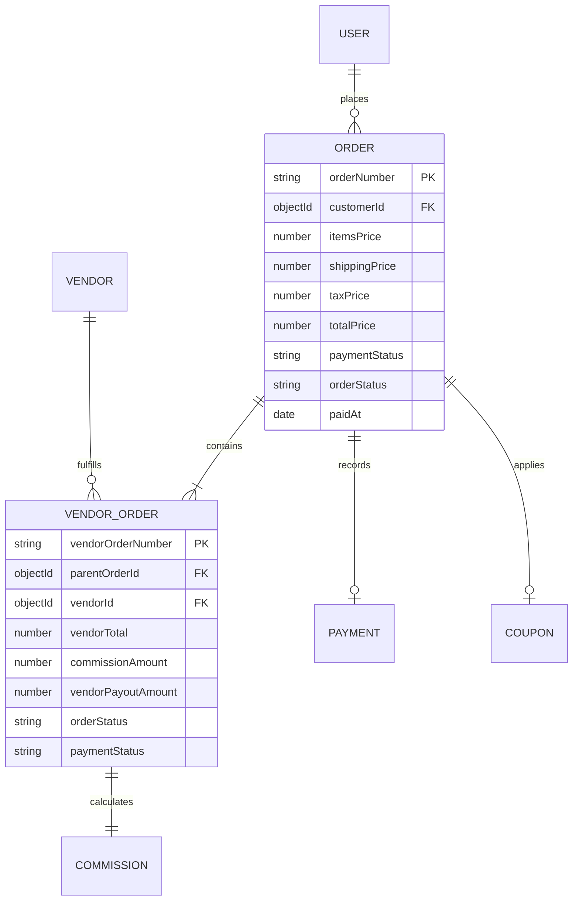

# MarketSphere Database & Data Architecture Specification

## 1. Storage & Database Overview

MarketSphere uses MongoDB (Mongoose ODM) with 13 interconnected schemas backed by Redis caching for Indian multi-vendor retail:
- **`User`**: Account identities, credentials, specification roles (`customer`, `vendor`, `admin`), active status, and SHA-256 hashed refresh tokens.
- **`Vendor`**: GST-registered vendor store profile, PAN, Indian bank details (IFSC), commission rate, ratings.
- **`Address`**: Dedicated customer delivery addresses with Indian PIN codes and 10-digit mobile numbers.
- **`Category`**: Hierarchical category taxonomy with automatic slug generation.
- **`Product`**: Catalog items with SKU, INR pricing, stock, attributes, configurable `gstRate` (0%, 5%, 12%, 18%, 28%), and text search indexes.
- **`Cart`**: Persistent user cart mapping customer accounts to selected catalog items with product-specific GST rates (persisted in Redis and MongoDB).
- **`Order`**: Parent order encapsulating checkout session, totals, shipping address, coupon deductions, initialized with `paymentStatus: 'pending'` and `paidAt: null`.
- **`VendorOrder`**: Suborders partitioned per vendor containing vendor items, commission cut, tracking, and synchronized payment status.
- **`Payment`**: Razorpay gateway transactions, order references, HMAC signatures, webhook audit logs, and refund status.
- **`Coupon`**: Promotional discount codes (percentage/fixed) with validity windows, subtotal caps, and minimum spend limits.
- **`Commission`**: Platform accounting records calculating take rate, 18% GST on platform service, and net vendor payout.
- **`Notification`**: In-app notifications for order milestones and payment confirmations.
- **`Review`**: Customer reviews restricted to 1 review per product per customer, automatically updating product rating averages.

---

## 2. Schema Specifications

### 2.1 Users Collection (`users`)
| Field | Type | Constraints / Description |
| :--- | :--- | :--- |
| `_id` | ObjectId | Primary Key |
| `name` | String | Required, trimmed, max 100 chars |
| `email` | String | Unique, lowercase, indexed |
| `password` | String | Bcrypt hash (cost factor 10), select: false |
| `role` | String | Enum: `['customer', 'vendor', 'admin']`, default: `'customer'` |
| `phone` | String | 10-digit mobile number |
| `vendorId` | ObjectId | References `vendors._id` (if vendor) |
| `wishlist` | [ObjectId]| References `products._id` |
| `refreshToken`| String | SHA-256 hash of active refresh token, select: false |
| `isActive` | Boolean | Default: `true` |

---

### 2.2 Products Collection (`products`)
| Field | Type | Constraints / Description |
| :--- | :--- | :--- |
| `_id` | ObjectId | Primary Key |
| `title` | String | Required, max 200 chars, indexed (text) |
| `slug` | String | Unique, lowercase, indexed |
| `description` | String | Required, indexed (text) |
| `vendorId` | ObjectId | References `users._id`, indexed |
| `categoryId` | ObjectId | References `categories._id`, indexed |
| `price` | Number | Required, INR (₹), min 0 |
| `discountPrice`| Number | Optional, min 0 |
| `stock` | Number | Required, non-negative integer, atomic reservation |
| `sku` | String | Unique, uppercase, indexed |
| `gstRate` | Number | Enum: `[0, 5, 12, 18, 28]`, default: `18` |
| `images` | [String] | Array of image URLs / S3 object URLs (min 1) |
| `status` | String | Enum: `['draft', 'published', 'archived']`, default: `'published'` |

---

### 2.3 Carts Collection (`carts`)
| Field | Type | Constraints / Description |
| :--- | :--- | :--- |
| `_id` | ObjectId | Primary Key |
| `userId` | ObjectId | Unique, references `users._id`, indexed |
| `items` | Array | Array of `{ productId, title, price, quantity, image, stock, slug, vendorId, gstRate }` |
| `updatedAt` | Date | Timestamp of last cart modification |

---

### 2.4 Orders & Suborders Collections (`orders`, `vendororders`)

#### Order Lifecycle States
- **Parent Order Creation:** Initialized with `paymentStatus: 'pending'` and `paidAt: null` for both Razorpay and COD payment methods.
- **VendorOrder Creation:** Child suborders inherit `paymentStatus: 'pending'`.
- **Payment Verification / Webhook:** Upon verified gateway signature or webhook event, parent `Order` and all child `VendorOrder` records transition atomically to `paymentStatus: 'paid'` with `paidAt: new Date()`.
- **Commission Allocation:** Associated `Commission` records transition from `'pending'` to `'eligible_for_payout'`.
